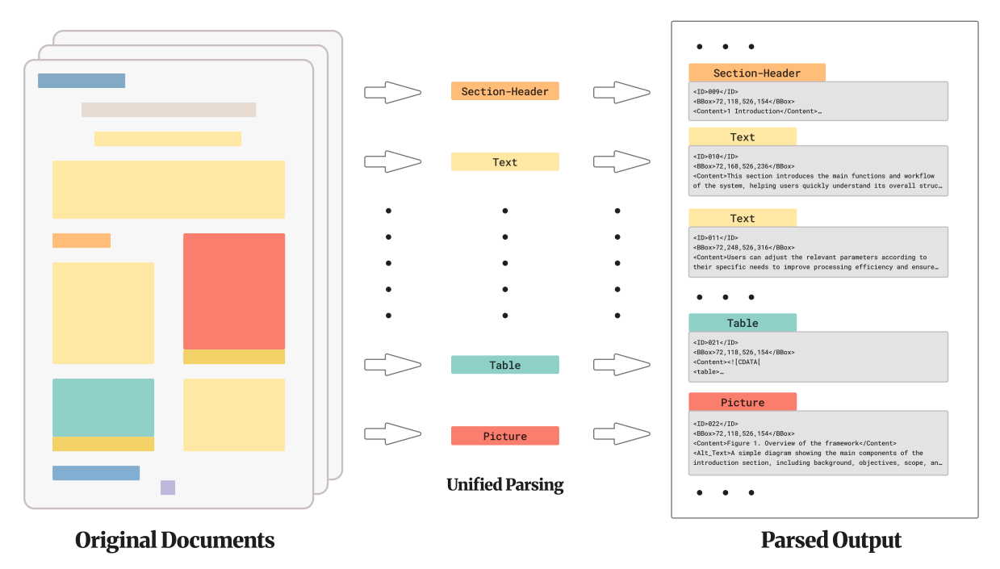
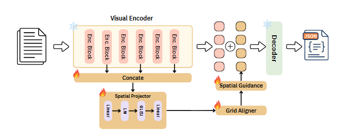

# Read, Parse, Describe: Unified Document Parsing with Visual Element Description Generation

**NeurIPS 2026**

Yuheng Chen<sup>&ast;1</sup>, Yufan Chen<sup>&ast;†1</sup>, Zhuojun Cai<sup>1</sup>, Ruiping Liu<sup>1</sup>, Junwei Zheng<sup>1</sup>, Jiale Wei<sup>1</sup>, Di Wen<sup>1</sup>, Weijia Fan<sup>1,3</sup>, Kunyu Peng<sup>1</sup>, Jiaming Zhang<sup>2</sup>, Rainer Stiefelhagen<sup>1</sup>

<sup>1</sup>Karlsruhe Institute of Technology, <sup>2</sup>Hunan University, <sup>3</sup>University of Alberta  
<sup>&ast;</sup>Equal contribution. <sup>†</sup>Corresponding author: Yufan Chen ([yufan.chen@kit.edu](mailto:yufan.chen@kit.edu)).

[Paper](https://openreview.net/) · [Project Page](https://huggingface.co/chen-doc-ai/Qwen3.5-2B_with_SARA) · [Dataset (Hugging Face)](https://huggingface.co/datasets/chen-doc-ai/Unified_Document_Understanding_Dataset) 

---

## 📖 Abstract

Document understanding systems are typically evaluated as separate components via layout analysis, optical text recognition, reading-order prediction, and image captioning. This separation leaves scientific figures, captions, and visual semantics weakly connected, and fails to measure whether a model can produce a single page-level parse that is both structurally faithful and semantically accessible. 

We introduce **Read-Parse-Describe**, a unified dataset for document parsing with visual element description generation. Given a page image, models are required to output an ordered list of layout elements containing bounding boxes, semantic labels, reading-order indices, recognized textual content, explicit caption linkages, and alternative text descriptions for visual elements. The benchmark is built from 2,402 documents, comprising 18,164 continuous pages, 125,218 layout elements, and 11,338 visual instances. 

Furthermore, we propose **SARA** (*Spatial Alignment Residual Adapter*), a lightweight plug-and-play space-awareness enhancer that reuses multi-layer visual features and injects grid-aware spatial guidance into vision-language tokens for layout-aware generation. Experiments across end-to-end VLMs and pipeline parsers show that existing systems struggle to jointly recover reading order and visual semantics, while our adapter-enhanced model achieves strong joint performance.


*(a) Unified document parsing contract with localized elements, reading order, text/HTML content, caption links, and visual descriptions. (b) Domain distribution across 2,402 source documents.*

---

## 🎯 Task & Unified Output Schema

Read-Parse-Describe models document understanding as a unified multimodal page-parsing contract. Given an input page image, the system predicts an ordered list of document elements sorted by human canonical reading order:

$$Y = [e_1, e_2, \dots, e_n]$$

Each element $e_i$ is structured under a unified schema:

$$e_i = \{\text{id}, \text{bbox}, \text{category}, \text{order}, \text{text}, \text{html}, \text{caption\_id}, \text{alt\_text}\}$$

| Field | Type | Description |
|---|---|---|
| `id` | `int` / `str` | Unique element identifier within the page. |
| `bbox` | `[x1, y1, x2, y2]` | Bounding box coordinates in page-coordinate image space. |
| `category` | `str` | Semantic layout category from the 23-class taxonomy. |
| `order` | `int` | Canonical human reading-order index. |
| `text` | `str` / `null` | Recognized text content for textual regions. |
| `html` | `str` / `null` | Structured HTML code for tabular structures. |
| `caption_id` | `int` / `null` | Cross-field link associating a visual object with its corresponding caption. |
| `alt_text` | `str` / `null` | Grounded, factual alternative text description for visual instances. |

### Core Contract Design Couplings

- **Element Identity:** Binds `id`, `category`, text, caption link, and alt-text to the same entity. Free-floating OCR or captions cannot be credited without the element they belong to.
- **Geometry as Evidence:** Treats `bbox` as the audit handle for all content ($IoU \ge 0.5$). Plausible text or descriptions tied to incorrect crops are explicitly penalized.
- **Canonical Reading Flow:** Sequences the page according to natural human reading flow, penalizing column and header ordering errors.
- **Caption & Alt-Text Semantics:** Requires explicit figure-caption binding and non-hallucinated, factual visual descriptions.

---

## 📊 Dataset Overview & Statistics

- **Source Corpus:** 2,402 open-access scientific PDF documents from the ACM Digital Library.
- **Scale:** 18,164 continuous page images, 125,218 layout elements, and 11,338 visual instances.
- **Page Curation Strategy:** First-8-page truncation per paper (retaining complete papers for shorter submissions). This retains the dense multimodal sections (abstract, methods, figures, tables, formulas) while filtering out visually monotonous reference listings.
- **Data Split:** Paper-level 90:5:5 split (Train: 90%, Val: 5%, Test: 5%) after deduplication via SHA-256 hashes and title/DOI matching to prevent cross-page stylistic leakage.

### Semantic Label Taxonomy (23 Categories)

The benchmark utilizes a granular 23-label taxonomy:

| Category Group | Labels | Description |
|---|---|---|
| **Structural Headers** | `sec_0`, `sec_1`, `sec_2`, `sec_3`, `sec_4` | Paper title and Heading levels 1 to 4 |
| **Body & Paragraphs** | `para`, `half_para` | Regular paragraphs and multi-column spanning paragraphs |
| **Scholarly Objects** | `fig`, `tab`, `equ`, `code` | Figures, tables, mathematical equations, and code blocks |
| **Captions** | `figure-cap`, `table-cap` | Figure and table captions |
| **Lists & Fragments** | `list`, `catalogue`, `anno`, `icon` | Itemized lists, catalogues, annotations, and conference logos |
| **Document Metadata** | `author-info`, `header`, `foot`, `fnote`, `watermark`, `reference` | Author details, headers/footers, footnotes, watermarks, reference items |

### Alt-Text Annotation & Quality Audit Pipeline

Visual instances were annotated through an automated generation, scoring, and human refinement triage loop:
1. Initial descriptions generated by Gemini 3 Pro and evaluated by Gemini 3 Flash on a 1–5 rubric (Accuracy, Completeness, Constraint Adherence).
2. All 1,408 descriptions scoring below 4 were routed to manual human refinement.
3. After refinement, the **Score-5 (Perfect Accessibility) rate increased from 66.2% to 98.1%**.
4. A manual agreement audit across 200 revised samples confirmed **97.0% (194/200)** exact human-LLM scoring agreement.

---

## 🧩 SARA: Spatial Alignment Residual Adapter



Modern VLMs often compress and merge visual tokens, degrading the spatial resolution required for fine-grained bounding-box regression and two-column reading flow. **SARA** restores spatial fidelity without updating the backbone:

1. **Multi-Layer Feature Reuse:** Reuses intermediate encoder layers $\mathcal{S} = \{2, 5, 8, 11\}$ and projects channel-concatenated features $X_{cat}$ into guidance representation $G$.
2. **Crop-Aware Grid Alignment:** Slices guidance segments corresponding to each crop grid $(t_i, h_i, w_i)$ and average-pools them to match the native merged token grid resolution $G'$.
3. **Residual Gated Injection:** Injects guidance directly into the native tokens $T$ via a learnable scalar gate $\lambda$:
   $$\hat{T} = T + \lambda G'$$

---

## 🔬 Benchmark Results

All models are evaluated on the held-out test split under the unified schema. Predictions are matched to ground-truth targets via IoU matching ($IoU \ge 0.5$ with category match).

### Main Results

| Setting | Model | Trainable Params | DLA F1 ↑ | DLA mIoU ↑ | OCR Acc. ↑ | RO Score ↑ | METEOR ↑ | Alt. Text BERT ↑ |
|---|---|---:|:---:|:---:|:---:|:---:|:---:|:---:|
| **Zero-shot** | GOT-OCR 2.0 | — | — | — | 0.8652 | 0.5330 | — | — |
| | Nougat | — | — | — | 0.7327 | 0.4640 | — | — |
| | Dolphin-v2 | — | 0.9124 | 0.9265 | 0.9307 | 0.8221 | — | — |
| | MonkeyOCR | — | 0.6030 | 0.8949 | 0.9684 | 0.6254 | — | — |
| | VGT | — | 0.6795 | 0.8540 | 0.6304 | 0.3833 | — | — |
| | PaddleOCR-VL | — | 0.7564 | 0.9458 | 0.9043 | 0.6619 | — | — |
| | PP-Structure V3 | — | 0.6375 | 0.8870 | 0.9558 | 0.5054 | — | — |
| | MinerU | — | 0.7171 | 0.9151 | 0.9671 | 0.6757 | — | — |
| | ChatGPT-5.4 | — | 0.6978 | 0.6454 | **0.9796** | 0.7253 | 0.3506 | 0.8751 |
| | GPT-5.6 | — | 0.7489 | 0.7781 | 0.9448 | 0.8967 | 0.3793 | 0.9004 |
| | Gemini 3.6 Flash | — | 0.6909 | 0.8658 | 0.9544 | 0.8183 | 0.3744 | 0.8841 |
| | Gemini 3.1 Pro | — | 0.7421 | 0.8551 | 0.9633 | 0.8337 | 0.3785 | 0.8961 |
| | Gemma4-E4B | — | 0.5473 | 0.7674 | 0.8977 | 0.5256 | 0.1679 | 0.8455 |
| | DeepSeek-OCR | — | 0.5987 | 0.6074 | 0.9064 | 0.5003 | 0.2562 | 0.8280 |
| | DeepSeek-OCR2 | — | 0.5806 | 0.5963 | 0.8688 | 0.4830 | 0.2604 | 0.8332 |
| **Full Fine-Tuning** | Qwen3.5-0.8B | 752.39M | 0.7177 | 0.8345 | 0.9475 | 0.9605 | 0.3666 | 0.8904 |
| | Qwen3.5-2B | 1881.83M | 0.7336 | 0.8350 | 0.9408 | 0.9628 | 0.3741 | 0.8928 |
| | Gemma4-E4B | 7463.01M | 0.9358 | 0.8836 | 0.9452 | 0.9628 | 0.3047 | 0.8821 |
| | DeepSeek-OCR | 2937.36M | 0.9644 | 0.9492 | 0.9679 | 0.9825 | **0.3998** | **0.8968** |
| | DeepSeek-OCR2 | 2935.88M | 0.8783 | 0.9189 | 0.9416 | 0.9231 | 0.3229 | 0.8094 |
| | Dolphin-v2 | 3085.93M | **0.9826** | **0.9588** | 0.9751 | **0.9857** | 0.3396 | 0.8838 |
| **Adapter Tuning** | Gemma4-E4B + LoRA | 103.82M | 0.7687 | 0.7238 | 0.9164 | 0.9451 | 0.2871 | 0.8753 |
| | Gemma4-E4B + SARA | 158.82M | 0.9437 | 0.9136 | 0.9474 | 0.9288 | 0.3009 | 0.8746 |
| | Qwen3.5-2B + LoRA | 48.37M | 0.7004 | 0.6845 | 0.9673 | 0.9304 | 0.3586 | 0.8652 |
| | **Qwen3.5-2B + SARA** | **83.99M** | **0.9189** | **0.8919** | **0.9636** | **0.9774** | **0.3834** | **0.8946** |

### Key Findings
1. **Pipeline Parsers vs. Unified Contract:** Systems like MinerU excel at OCR (0.9671 Acc) and localization (0.9151 mIoU), but lack caption linkage, drop reading-order sequencing (0.6757 RO), and generate no visual descriptions.
2. **SARA Efficiency:** On frozen Qwen3.5-2B, tuning only 83.99M parameters with SARA boosts DLA F1 from 0.7336 to 0.9189, mIoU from 0.8350 to 0.8919, and RO Score from 0.9628 to 0.9774 compared to full fine-tuning.

---

## 📦 Dataset Access & Format

The dataset will be available on Hugging Face.

### File Hierarchy

```text
Read-Parse-Describe/
├── images/                  # Rendered high-resolution page images (PNG)
├── annotations/
│   ├── train.jsonl          # 90% training split (ordered element lists)
│   ├── val.jsonl            # 5% validation split
│   └── test.jsonl           # 5% test split
└── metadata/
    └── documents.jsonl      # Source paper metadata (DOI, title, ACM URL, license)

---
## 📝 Citation

```bibtex
@inproceedings{chen2026readparsedescribe,
  title     = {Read, Parse, Describe: Unified Document Parsing with Visual Element Description Generation},
  author    = {Chen, Yuheng and Chen, Yufan and Cai, Zhuojun and Liu, Ruiping and Zheng, Junwei and Wei, Jiale and Wen, Di and Fan, Weijia and Peng, Kunyu and Zhang, Jiaming and Stiefelhagen, Rainer},
  booktitle = {Advances in Neural Information Processing Systems (NeurIPS)},
  year      = {2026}
}
```

---

## 📬 Contact

- **Yuheng Chen**: [yuheng.chen@student.kit.edu](mailto:yuheng.chen@student.kit.edu)
- **Yufan Chen** (Corresponding Author): [yufan.chen@kit.edu](mailto:yufan.chen@kit.edu)
